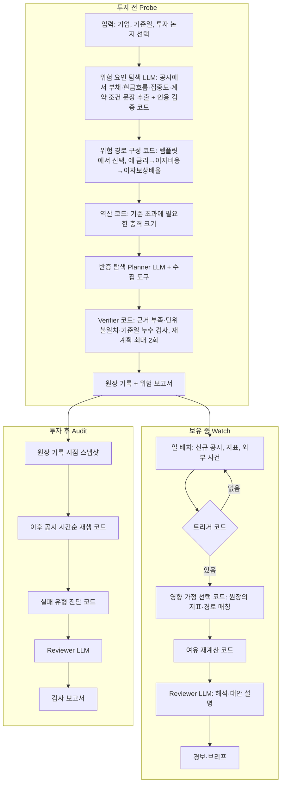

# PLANS — RiskProbe (가칭): 투자 가정 전 주기 위험 에이전트

> 「국부펀드 KIC, AI 에이전트 공모전」 출품용. 예선 기획서 **11/12**, 본선 산출물 **12/22**.
> 상태 표기: **완료** / **진행 중** / **진행 예정** / **미정** / **보류**
> 이력: v1 투자 가설 시간순 재생 → v2 투자 판단 감사(Decision Audit) → **v3 투자 전·중·후 전 주기 통합 (현재)**

---

## 1. 개발 계획

### 1.1 일정

| 단계 | 기간 | 내용 | 완료 조건 | 상태 |
|---|---|---|---|---|
| **P0 기반** | 10/17 ~ 10/24 | 저장소 뼈대, 공용 코드 이식(6장), SEC·DART 기준일 복원 확인, `SOURCES.md` | 샘플 기업 1곳의 2개 이상 시점을 원문·공개일·버전과 함께 재구성. DART 정정 전 값 복원 가능 여부 결론 | **완료** (`docs/p0_findings.md`. 이식은 HTTP·설정·테스트·SEC만, LLM·파이프라인은 쓰는 단계에서 이식) |
| **P1 공유 엔진** | 10/25 ~ 11/5 | 지표 카탈로그, Point-in-Time 저장소, 가정 원장, 역산 엔진 | 날짜 필터·지표 계산·역산 자동 테스트 통과 | **완료** (`docs/p1_findings.md`, 테스트 46개). 데모 기업 선정·기본 규칙 값 확정은 사용자 결정 대기 |
| **P2 Probe + 예선** | 11/1 ~ 11/11 | Probe 최소 버전(조건 추출 → 역산), 기획서 10쪽 PDF, 파이프라인 그림 | 실제 기업 1건 Probe 결과를 기획서에 첨부 | Probe 최소 버전 **완료**(`scripts/probe.py`, `docs/samples/`). 기획서는 **보류**(사용자 요청, 2026-10-17) |
| **예선 제출** | **11/12 10:00** | 기획서 PDF | 제출 | - |
| **P3 Audit + Probe 완성** | 11/13 ~ 11/27 | 시간순 재생, 실패 유형 진단, Probe 반증 탐색, LLM 추출·인용 검증, **Streamlit 최소 앱 첫 배포** | 가정 2개 이상에서 시점별 상태·유형 판정 재현, 데모 URL에서 Probe·Audit 동작 | **진행 중**: Audit 재생·실패 유형·8-K 이벤트 완료(`scripts/audit.py`), 기업 전망·메모 가설 모드 완료(`scripts/thesis.py`). Probe 반증 탐색 완료, Streamlit 최소 앱 완료(`app/streamlit_app.py`, `docs/deploy.md`). 남음: **사용자의 Streamlit Cloud 배포** |
| **P4 Watch** | 11/28 ~ 12/10 | 트리거(정기공시 재평가·8-K·금리), 영향 가정만 재평가, 사건 시나리오 포트폴리오 점검, 알림 | 감시 목록 3~5개 기업으로 일 배치가 돌고, 트리거 발생 시 보고서 생성 | **완료(지정학·뉴스 제외)**: `scripts/watch.py`, `.github/workflows/watch.yml`(평일 매일, Issue 경보), 앱 Watch 탭 |
| **P5 통합·데모** | 12/11 ~ 12/21 | Streamlit 통합(P3에서 먼저 배포한 앱에 탭 추가), 데모 시나리오 3건, 발표자료, 시연 영상 | 데모 URL에서 Probe → Watch → Audit 한 흐름이 처음부터 끝까지 동작 | 진행 예정 |
| **본선 제출** | **12/22 10:00** | 실행 코드, 데모 URL, 발표자료 | 제출 | - |

### 1.2 우선순위 (시간이 모자랄 때 자르는 순서)

1. **반드시**: 공유 엔진(P1), Probe 역산, Audit 재생·실패 유형
2. **가능하면**: Probe 반증 탐색, Watch 공시 트리거
3. **여유 있으면**: Watch 외부 사건 트리거·포트폴리오 점검, DART 재무값 기준일 복원
4. **추후**: 9장 항목 전부

### 1.3 작업 원칙
- 데이터 계층 → 분석 계층 → Agent → UI 순서로 작은 단위로 진행한다.
- 기준일 필터 테스트를 Agent·UI보다 먼저 만든다.
- 각 단계가 끝나면 이 문서의 상태와 실행법·테스트 결과를 갱신한다.

---

## 2. 서비스 정의

### 2.1 한 문장
투자 판단이 **어떤 조건에서 틀릴 수 있는지** 투자 전에 찾아 기록하고, 보유 중에는 그 조건에 가까워지는지 상시 감시하며, 투자 후에는 그 판단이 **왜, 어떤 종류로** 틀렸는지(또는 맞았는지) 감사하는 AI Agent.

### 2.2 핵심 질문
"이 기업은 위험한가?"가 아니다.
**"이 투자가 괜찮다는 판단은 어떤 조건에서 틀리고, 지금 그 조건에 얼마나 가까우며, 그 근거는 무엇인가?"**

### 2.3 세 모드와 가정 원장

```
            ┌──────────── 가정 원장 (Assumption Ledger) ────────────┐
            │ 가정 · 깨지는 조건 · 지표 · 임계값 · 근거 · 기록 시점 │
            └──────▲──────────────────▲─────────────────▲────────────┘
                   │ 기록             │ 재평가          │ 재생·진단
   [투자 전] Probe ┘  [보유 중] Watch ┘  [투자 후] Audit ┘
   깨지는 조건 탐색     조건까지 거리 감시     실패 유형 진단
   역산 · 반증 탐색     트리거 → 영향 가정만    최초 경고 시점
```

| 모드 | 언제 | 하는 일 | 결과물 |
|---|---|---|---|
| **Probe** | 투자 검토 시 (건마다) | 공시에서 위험 요인 탐색 → 위험 경로 구성 → 깨지는 조건 역산 → 반증 탐색 | 위험 보고서, 가정 원장 기록 |
| **Watch** | 보유 중 (상시) | 지표 이상·신규 공시·외부 사건 발생 시 영향받는 가정만 재평가 | 조건까지 남은 여유 갱신, 경보·브리프 |
| **Audit** | 사후 리뷰 (분기·반기, 비정기) | 원장 기록 시점 기준으로 이후 공시를 시간순 재생 | 실패 유형 진단, 최초 경고 시점, 위원회 보고서 |

원장이 세 모드를 잇는다. Probe가 투자 시점에 남긴 기록이 Watch의 감시 대상이 되고, Audit의 입력이 된다. 그래서 사후 감사에서 "과거 메모를 어디서 구하나"라는 문제가 없어진다. 원장이 없는 과거 사례는 기업 공식 전망이나 사용자 메모로 원장을 만든다.

### 2.4 확률을 만들지 않는다
실제 확률을 추정할 데이터가 없으면 확률을 제시하지 않는다. 위험도는 **"깨지는 조건까지 남은 여유"**로 표현한다.
- 예: "이자보상배율 기준 1.5배까지 EBITDA 기준 22% 여유" / "금리 +180bp에서 기준 초과"
- 위험 등급(여유 충분 / 근접 / 초과)은 이 여유를 코드 규칙으로 구간화한 것이며, 규칙과 구간 경계를 화면에 노출한다.

---

## 3. 문제 정의와 사용 상황

### 3.1 문제
- **투자 전**: 위험 검토가 "위험 요인 나열"에 그치고, 그 위험이 **어느 수준에서 현실이 되는지**는 계산하지 않는다. 안전하다는 결론에 반대되는 자료는 덜 찾는다(확인 편향).
- **보유 중**: 사건이 생기면 "우리 보유 자산 중 어디가 영향받나"를 사람이 하나씩 다시 계산한다.
- **투자 후**: 결과만 보고 판단을 평가하면 가정 무리, 신호 놓침, 상황 변화, 일시적 흔들림을 구분할 수 없다. 국민 자산을 운용하는 기관은 "당시 이용 가능한 정보로 합리적인 판단이었는가"를 설명할 책임이 크다.

### 3.2 사용 상황

| # | 상황 | 사용자 | 빈도 | 모드 |
|---|---|---|---|---|
| 1 | 신규 투자 검토·실사 | 리서치 애널리스트, 운용역 | 건마다 | Probe |
| 2 | 금리·환율 급변, 지정학 사건 발생 시 "어디가 영향받나" | 리스크 관리 | 사건마다 | Watch (사건 트리거) |
| 3 | 보유 기업 신규 공시·지표 이상 | 포트폴리오 매니저 | 상시 | Watch (공시·지표 트리거) |
| 4 | 실적 시즌 보유 자산 점검 | 포트폴리오 매니저 | 분기 | Watch 일괄 재평가 |
| 5 | 성과 미달 자산 사후 리뷰 | 투자심의 지원, 사후관리 | 분기·반기 | Audit |
| 6 | 손실 설명 요구 대응 (내부 감사, 이사회, 외부 질의) | 투자관리·감사 대응 | 비정기 | Audit |

---

## 4. 차별화

| 기능 | 기존 서비스 | 이 서비스 |
|---|---|---|
| 공시 위험 요인 요약 | 많음 (10-K 요약 도구 등) | 기본 기능일 뿐 핵심 아님 |
| 약정(covenant) 추출·여유 추적 | 있음 (Octus CreditAI, V7 등, 주로 사모 신용) | 추후 기능 |
| 가설 상태 판정·시간순 이력 | 있음 (TickerTrac, readouts.ai, Helm 등, 개인 투자자용) | 있음 + 공개일 기준 엄격 분리 |
| **깨지는 조건 역산** (얼마의 충격에서 기준 초과) | 찾지 못함 | **핵심** |
| **반증 탐색** (결론과 충돌하는 공시·수치) | 찾지 못함 | **핵심** |
| **투자 전·중·후를 하나의 가정 원장으로 연결** | 찾지 못함 | **핵심** |
| **판단 실패 유형 진단** | 찾지 못함 | **핵심** |
| 확률 대신 조건부 여유로 위험 표현 | 드묾 | 원칙 |

데모로 증명한다: 한 기업을 Probe(투자 시점) → Watch(사건 발생) → Audit(사후)로 이어서 보여준다.

---

## 5. Agent 설계

### 5.1 파이프라인



### 5.2 LLM과 코드 역할 분담 (비용 최소화)

| LLM (호출은 필요할 때만) | 코드 |
|---|---|
| 공시·메모에서 위험 요인·전망·계약 조건 문장 추출 (원문 인용 필수) | 인용문이 원문에 있는지 검사 |
| 투자 논지를 가정으로 분해, 지표 카탈로그·경로 템플릿에서 선택 | 지표 계산, 날짜 필터, 버전 관리 |
| 반증 탐색 검색 계획 | 역산, 여유 계산, 위험 등급 구간화 |
| 가설 문서가 특정 신호를 언급했는지 판정 (인용 필수) | 트리거 감지, 영향 가정 매칭 |
| 근거 해석, 대안 설명 문장 | 실패 유형 판정, 보고서 숫자 채우기 |

- 숫자는 LLM이 쓰지 않는다. 보고서 문장은 `[[fact_key]]` 자리표시자로만 숫자를 인용하고 코드가 치환한다. 자리표시자 밖에서 숫자가 나오면 감사에서 탈락한다.
- Watch는 트리거가 없으면 LLM을 호출하지 않는다. 평상시 비용은 0이다.
- 같은 요청은 디스크 캐시로 재사용한다(재현성·비용).
- LLM 키가 없으면 규칙 기반 계획과 템플릿 보고서로 동작한다.

### 5.3 구성 요소

| 구성 | 내용 |
|---|---|
| **지표 카탈로그** | 15~20개 고정 지표. 계산식, US-GAAP 태그, K-IFRS 계정, 단위를 코드로 정의. 예: 매출 YoY, 매출총이익률, 영업이익률, EBITDA, 이자보상배율, 순차입금/EBITDA, 영업현금흐름/순이익, 재고 증가율 − 매출 증가율, 매출채권 회전일수, CapEx/매출, 단기차입 비중 |
| **위험 경로 템플릿** | 코드로 정의한 인과 경로. 예: 금리 → 변동금리 부채 이자비용 → 이자보상배율 / 매출 감소 → EBITDA → 순차입금/EBITDA / 환율 → 외화부채 원화 환산액 / 고객 집중 → 주요 고객 이탈 시 매출. LLM은 경로를 새로 만들지 않고 템플릿에서 고른다 |
| **역산 엔진** | 경로마다 "위험 기준을 넘는 충격 크기"를 닫힌 식이나 수치 탐색(이분법)으로 계산. 기준값은 사용자 입력 → 공시된 약정·정책 수치 → 기본 규칙 순으로 쓰고, 출처를 표시 |
| **Point-in-Time 저장소** | 모든 값에 `period_end`, `published_at`, `retrieved_at`, `source_document_id`, `version`. 기준일 T 분석에는 `published_at <= T`만 노출. 정정 공시는 새 버전으로 보존 |
| **가정 원장** | `id`, `statement`, `type`, `indicators`, `path_template`, `threshold`(값·출처), `direction`, `horizon`, `source_quote`, `recorded_at`, `user_confirmed`, 상태 이력 |
| **트리거** | (1) 지표 이상: 신규 분기 값이 원장 조건의 여유를 줄이거나 기준 초과 / (2) 신규 공시: 8-K·DART 주요사항 보고 중 원장 지표·경로와 관련된 유형 / (3) 외부 사건: 금리·환율·유가 급변(일간 z-score), 지정학 사건(GDELT) → 해당 위험 동인을 가진 가정만 재평가 |
| **실패 유형 진단** | 가정 무리 / 신호 놓침 / 상황 변화 / 일시적 흔들림 / 가정 유지 / 판단 불가. 판정 규칙은 7.3 |

---

## 6. 재사용 코드 (기존 저장소에서 이식)

| 가져올 것 | 출처 | 용도 |
|---|---|---|
| HTTP 캐시·호스트별 요청 간격·키 제거, 가짜 HTTP | `fund-reversing-ai/tracer/http.py`, `tests/fakes.py` | 수집, 네트워크 없는 테스트 |
| SEC·DART 기업 식별, 공시 URL | `fund-reversing-ai/tracer/sources/sec.py`, `dart.py` | 수집 어댑터 |
| 원문 인용 검증 | `fund-reversing-ai/tracer/extract.py` (`verify`) | 추출 결과 검증 |
| 공시 제목 키워드 분류 | `fund-reversing-ai/tracer/events/root_cause.py` | Watch 공시 트리거, Audit 타임라인 태깅 |
| LLM 어댑터(Gemini/Claude, 캐시, 재시도), 숫자 자리표시자 감사 | `kr-fund-ai-agent/sentinel/agents/llm.py` | 전 모드 |
| Planner → Executor → Verifier(재계획 ≤2) → Reviewer | `kr-fund-ai-agent/sentinel/agents/pipeline.py` | Probe·Watch 파이프라인 |
| 도구 반환 형식(값 + 근거 + 한계), 데이터 품질 검사 | `kr-fund-ai-agent/sentinel/tools.py`, `data/quality.py` | 전 모드 |
| 시장 변수 일간 z-score, GDELT 감시, 예약 실행·Issue 경보 | `kr-fund-ai-agent/sentinel/monitor.py`, `gdelt_monitor.py`, `.github/workflows/monitor.yml` | Watch 외부 사건 트리거 |
| 연준 H.15 금리, H.10 환율, EIA 유가 수집 | `kr-fund-ai-agent/sentinel/data/sources.py` | Watch 시장 변수 |

재사용한 코드도 `SOURCES.md`에 출처를 기록한다.

---

## 7. 모드별 상세

### 7.1 Probe (투자 전)
1. **입력**: 기업, 기준일(기본값 오늘), 투자 논지(선택: 사용자 메모 / 기업 공식 전망 / 없음)
2. **위험 요인 탐색**: 최근 정기 공시에서 부채 구조(만기, 변동금리 비중, 통화), 현금흐름, 사업·고객 집중도, 주요 계약·약정 조건 문장을 추출한다. 인용이 확인된 것만 남긴다.
3. **위험 경로 구성**: 탐색 결과에 맞는 경로 템플릿을 고르고, 경로에 필요한 값이 공시에 있는지 확인한다. 없으면 "값 없음"으로 표시하고 경로를 계산하지 않는다.
4. **역산**: 경로마다 기준 초과에 필요한 충격 크기를 계산한다. 결과는 "조건부 계산"으로 라벨링하고 계산식·입력값·기준 시점을 노출한다.
5. **반증 탐색**: 현재 결론(예: "재무 안정")과 충돌하는 공시·수치를 찾는다. 예: 단기차입 비중 증가, 영업현금흐름과 순이익 괴리, 감사의견·계속기업 관련 문구, 약정 수정(waiver) 공시.
6. **보고서**: 위험 요인, 발생 조건(역산 결과), 근거, 반증, 불확실성, 추가 확인 사항. 승인된 가정은 원장에 기록한다.

### 7.2 Watch (보유 중)
- **실행**: 일 1회 배치(GitHub Actions 예약 실행). 공시 트리거는 SEC submissions·DART 공시 목록, 시장 변수는 공공 데이터(연준·EIA), 지정학은 GDELT.
- **동작**: 트리거 발생 → 원장에서 영향받는 가정만 선택 → 여유 재계산 → 등급이 바뀌거나 기준에 근접하면 경보와 브리프를 생성한다.
- **사건 기반 포트폴리오 점검**: "금리 +100bp" 같은 사건 시나리오를 입력하거나 감지된 사건에서 받으면, 감시 목록 전체의 해당 경로 여유를 다시 계산해 **기준 초과 / 근접 자산 목록**을 낸다. 시나리오 크기는 사용자 입력 또는 과거 유사 사건의 실측값(출처 표시)을 쓰고, 지어내지 않는다.
- **이상 감지 기준**: 시장 변수는 일간 robust z-score(kr-fund 방식), 공시는 유형 규칙, 지표는 여유 감소폭. 모두 코드 규칙이다.

### 7.3 Audit (투자 후)
- 원장 기록 시점(또는 사용자가 정한 기준일)의 스냅샷을 고정하고, 이후 공시를 시간순으로 하나씩 추가하며 가정 상태(`supported` / `weakened` / `mixed` / `insufficient`)를 갱신한다.
- **실패 유형 판정 규칙 (초안, 데모로 검증 후 확정)**

| 유형 | 규칙 |
|---|---|
| 가정 무리 | 기준일 시점 역산 결과, 가정 성립에 필요한 수치가 기준일 이전 실적 범위를 벗어남 |
| 신호 놓침 | 기준일 스냅샷에서 이미 `weakened`인 조건이 있고, 가설 문서가 그 신호를 언급하지 않음 (언급 여부는 LLM이 인용과 함께 판정, 코드가 인용 검증) |
| 상황 변화 | 기준일 `supported` → 이후 `weakened` 전환 후 다음 공시까지 회복하지 않음 |
| 일시적 흔들림 | `weakened` 전환 후 다음 공시에서 회복 |
| 가정 유지 | 종료일까지 `supported` |
| 판단 불가 | 근거 부족 |

- "최초 경고 시점"은 기계적 신호가 처음 관측된 공시일이다. 그날 매도했어야 한다는 뜻이 아니고, 원인이라고 단정하지 않는다.
- 원장이 없는 과거 사례의 가설은 **기준일에 공시된 기업 공식 전망**으로 만든다(작성 시점이 공시일로 고정돼 사후 편향이 없음). 사용자 메모는 별도 입력 모드로 지원한다.

---

## 8. 데이터·신뢰성 원칙

- 기준일 이후 공개 자료가 기준일 분석에 섞이지 않는 것이 최우선이다. 자동 테스트로 보장한다.
- 확률을 만들지 않는다. 조건부 시나리오와 여유로 표현한다.
- 원문 근거가 없는 주장은 검증 완료로 표시하지 않는다. 사실, 계산, 추론, 미확인 사항을 UI에서 분리한다.
- 이상 신호를 부정·위법으로 단정하지 않고, 동시 발생을 인과로 표현하지 않는다.
- 도구는 값 + 근거(evidence) + 한계(unknowns)를 반환한다. unknowns 메시지에는 숫자를 쓰지 않는다.
- 수집 실패·누락 기간을 성공으로 가장하지 않는다.
- 알려진 한계: 미국 기업은 실적을 8-K 보도자료로 먼저 공개하고, 그 숫자는 XBRL에 없다. 그래서 XBRL 기준 공개일이 실제 최초 공개일보다 늦을 수 있고, 이를 보고서에 표시한다.
- 데모 사례는 결과를 알고 고르기 때문에 선택 편향이 있다. 기획서 한계 항목에 명시한다.
- KIC의 인프라·대체투자는 대부분 비상장이라 공시가 없다. MVP는 상장사를 대상으로 하고, 비상장 자산은 사용자 업로드 문서로 확장한다(9장).

### 평가 지표

| 지표 | 목표 |
|---|---|
| Point-in-Time 무결성 (기준일 분석에 이후 자료 유입) | 0건 |
| 인용 정확도 (인용문이 원문에 존재) | 100% (코드 검증) |
| 재현성 (같은 입력·스냅샷 → 같은 결과) | 100% |
| 실패 유형 판정의 사람 검토 일치율 | 측정 후 보고 (표본이 적으면 한계 명시) |
| Watch 경보 정밀도 (사람이 유효하다고 본 비율) | 측정 후 보고 |
| 건당 소요 시간·LLM 비용, Watch 일 배치 비용 | 측정 후 보고 |

### 필수 테스트
기준일 이후 공시 배제 / 정정 공시 버전 보존 / 원문에 없는 인용 거부 / 근거 부족 시 `insufficient` / 단위·통화·회계기간 불일치 비교 거부 / 수집 실패 사유 표시 / 역산 결과 재현 / 경로에 필요한 값이 없으면 계산 거부 / 트리거 없으면 LLM 미호출 / 실패 유형 규칙별 단위 테스트.

---

## 9. 화면 (Streamlit)

| 탭 | 내용 |
|---|---|
| Probe | 기업·기준일 입력, 위험 요인, 위험 경로, 역산 결과(여유 표·차트), 반증, 원장 기록 승인 |
| Watch | 감시 목록과 조건별 여유·등급, 최근 트리거와 브리프, 사건 시나리오 입력 → 기준 초과·근접 자산 목록 |
| Audit | 공시 단위 재생 슬라이더, 가정별 상태 타임라인, 실패 유형 진단, 최초 경고 시점 |
| 보고서 | Probe 위험 보고서, Audit 감사 보고서, Markdown 내보내기 |
| 데이터·출처 | 수집 기록, 공개일, 버전, 실패 항목 |

---

## 10. MVP 범위

**포함**
- 공유 엔진: 지표 카탈로그, Point-in-Time 저장소, 가정 원장, 역산
- Probe: 위험 요인 추출, 경로 템플릿 5개 내외, 역산, 반증 탐색
- Watch: 일 배치, 공시·지표 트리거, 시장 변수 트리거, 사건 시나리오 포트폴리오 점검, GitHub Issue 경보
- Audit: 시간순 재생, 실패 유형 진단
- 데이터: SEC, DART (순서는 11장 미정)
- 데모 시나리오 3건: (1) 한 기업의 Probe → Watch → Audit 전 주기, (2) 금리 급등 사건 → 감시 목록 점검, (3) 기업 공식 전망 Audit

**제외 (추후)**
- **AI 자체의 사후 편향 차단**: 기업명·날짜를 가려 LLM에 넣고, 가린 입력과 원래 입력의 결과 차이로 누수 검사 (참고: HindsightBench, Look-Ahead-Bench, 2026)
- 약정 문서(credit agreement) 원문 추출과 약정 여유 역산
- 비상장 자산(사용자 업로드 문서), 위탁운용사 투자 논리 감사
- 경영진 전망 신뢰도 누적 점수
- 뉴스 전수 검색, 실적 보도자료(8-K Exhibit 99) 숫자 추출
- 가치평가(DCF) 기반 스트레스 테스트, PDF 보고서, MCP 서버 공개, 텔레그램·슬랙 알림
- 매매 추천, 목표주가, KIC 내부 시스템 연동

---

## 11. 미정 사항

| 항목 | 내용 | 선택지 |
|---|---|---|
| 위험 등급 구간 경계, 실패 유형 세부 기준 | 연속 분기 수, 근접 기준 등 | 데모 사례로 검증 후 확정 |
| 감시 주기 | 일 1회 vs 더 짧게 | 공시는 일 1회로 충분. 시장 변수·GDELT는 kr-fund 방식(15분) 재사용 여부 결정 필요 |
| 최종 서비스명 | RiskProbe는 가칭 | 미정 |

---

## 12. 확정된 결정

| 항목 | 결정 |
|---|---|
| 제출작 | 이 저장소. `fund-reversing-ai`, `kr-fund-ai-agent`는 코드 공급원으로만 사용 |
| 포지셔닝 | 투자 전(Probe)·중(Watch)·후(Audit) 전 주기 통합, 가정 원장으로 연결 |
| 위험 표현 | 확률 대신 조건부 시나리오와 여유 |
| 데모 가설 출처 | 기업 공식 전망 + 사용자 메모 모드 |
| UI | Streamlit (Streamlit Cloud 배포) |
| 데이터 | SEC + DART. **SEC를 먼저 완성**하고 DART를 같은 인터페이스로 붙임 (`riskprobe/sources/market.py`가 입력으로 소스 선택: `KR:종목코드` 또는 한글 이름 → DART) |
| 기업 입력 (2026-10-17) | 회사 이름·종목코드·CIK 검색 + 후보 선택(SEC `company_tickers.json`, 한국 상장사 `data/dart_corps.json`, LLM 없음). 외국 기업 양식(20-F·40-F), 금융업(SEC SIC 6000~6499, 한국 KSIC 64~66)은 "지표 신뢰도 낮음" 경고를 카드 맨 위에 표시. 리츠(6798)는 경고 없음 |
| DART 재무값 (2026-10-17) | **빠른 방식**: 보고서별 재무 API(본문 재무제표)를 병렬 호출. 정정된 보고서는 정정 후 값만 주므로 정정일에 공개된 값으로 처리(미래 값 유입 없음, 정정 전 값은 공백). 원본 XBRL 복원은 추후. 총차입금 = 본문의 차입금·사채·리스부채 합(국내 신용평가 관행, 리스 포함). 감가상각비가 본문에 없으면 EBITDA 대신 영업이익(EBIT) 기준으로 계산하고 카드에 표시. 한국 사업보고서 본문 LLM 추출·회사 전망은 아직 없음 |
| 한국 수시공시 | 주요사항보고서·거래소공시 제목 규칙(`sources/dart.EVENT_RULES`). 회생·파산·부도·채권단 관리 → 1.03, 기한의 이익 상실 → 2.04로 매핑해 강제 규칙 적용 |
| 한국 금리 | 한국은행 ECOS CD 91일(변동금리 기준)·국고채 3년(재조달). `ECOS_API_KEY` 필요 |
| Watch 감시 대상 | **보유 기업 감시 목록** (공시·재무·시장 변수). 펀드·ETF 자금 유출입은 하지 않음 |
| DART 정정 전 값 | 재무 API는 정정 후 값만 줌 → 원본 접수번호로 XBRL 원문(`fnlttXbrl.xml`)을 받아 파싱 가능(P0 확인). 지금은 빠른 방식을 쓰고 원본 복원은 보류 |
| SEC 데이터 품질 규칙 | 대상 기간 밖이면서 직전 값을 바꾸는 값 제외, 음수일 수 없는 항목의 음수 값 제외(부호를 고치지 않음), 재작성(10-K·정정·8-K) 전후 값 혼합 금지, 지표별 대체 태그, 영업이익 태그가 없으면 법인세차감전이익 + 이자비용으로 대체하고 표시 (`docs/p1_findings.md`) |
| AI 사후 편향 차단 | 추후 기능 |
| Probe 판정·문장 분담 | 결론(경로별 상태·충격·등급)은 코드가 쓰고, LLM은 숫자 없이 "공시 위험 요인과 경로의 연결"과 "추가 확인 질문"만 씀(감사 실패 시 제외). 공시 약정 기준값은 정의가 달라 기본 규칙을 대체하지 않고 별도 시나리오로 계산 |
| Audit 판정 | 각 시점은 그 공시일까지 공개된 정보만으로 재계산. 상태: 유지/약화/혼합(공시·조정 EBITDA 엇갈림)/근거 부족, EBITDA ≤ 0은 약화. 실패 유형은 코드 규칙(`riskprobe/audit.py`), 가정 무리는 "기준일 여유 < 기준일 전 5년 최악 EBITDA 감소"일 때 표시. 기준일 전 경고성 수시공시는 참고로만 표시 |
| 수시공시(8-K) 분류 | 항목 번호 규칙 + 7.01/8.01은 본문·EX-99 키워드 규칙(재해, 소송, 신용등급, 배당, 유동성, 전략 검토). LLM 없음 |
| 전망·메모 가설 | 실적·공정공시(8-K 2.02/7.01) EX-99의 전망 문장을 키워드로 고르고 LLM이 인용과 함께 목표를 추출, 코드가 검증·파싱. 기준값 = 범위 하단. Audit에서는 이후 발표가 같은 지표 전망을 다시 말한 하단으로 판정, 실적 발표에서 언급이 사라지면 "전망 미언급". 메모는 같은 추출을 메모 원문에 대해 검증(사후 편향 주의 표시) |
| Watch 트리거 | ① 기간 중 새 정기공시로 가정 재평가, 상태 악화 시 경보 ② 8-K 고·중 위험 ③ SOFR 또는 국채 10년물이 기간 중 25bp 이상 변동(기본 규칙) 시 금리 경로 재계산(원장에 기록한 변동금리 차입금, 기록 이후 SOFR 변화 차감). LLM 호출 없음 |
| 사건 시나리오 | 금리 충격(bp, 원장의 변동금리 차입금에 적용)과 EBITDA 충격(%)을 감시 목록 전체에 적용해 초과·근접·유지 판정 |
| 금리 데이터 | SOFR(뉴욕 연준 API), 국채 10년물(연준 H.15), 키 불필요 |
| 지정학·업종 뉴스 감시 | 보류 (kr-fund GDELT 감시 재사용 가능). 지금은 회사가 8-K로 공시한 사건만 잡음 |
| 통합 판정 방식 (2026-10-17) | 규칙형 → **점수 + 강제 규칙**. 가정 점수 = 기준 초과 정도(1~3점) × 기준값 출처 가중(기본 규칙 0.7) + 기준일 대비 악화 1 (기준일부터 초과·악화 없음 ×0.5), 혼합 1, 근접 0.5. 공통: 최근 90일 8-K(고 2·중 1, 최대 3), 시나리오 1. 합계 3 이상 재검토 필요, 2 이상 주의, 기준 초과 가정이 있으면 최소 주의. 강제 규칙: EBITDA ≤ 0, 최근 1년 8-K 1.03·2.04·4.02. 가중치는 `config.VERDICT_SCORE`(설정 파일만), 카드에 점수 내역 표시. 점수는 확률이 아님 |
| 통합 검토 (2026-10-17) | 입력 하나(기업 + 판단 기준일 + 점검일) → 출력 하나(판단 카드). 기준일 Probe → 점검일까지 한 번 재생(Audit 루프) → 금리 남은 여유·시나리오(Watch) → 종합 판정. 판정 규칙: 재검토 필요(점검일 약화 가정) / 주의(혼합·근접, 최근 90일 고위험 8-K, 시나리오에서 유지 가정이 깨짐) / 유지. 회사 전망은 선택 옵션. 앱 메인 탭, 기존 세 탭은 상세로 유지 (`riskprobe/lifecycle.py`, `scripts/review.py`) |
| 배포 시점 | P3 끝(11월 말)에 Probe·Audit 최소 앱을 Streamlit Cloud에 먼저 배포하고 이후 탭 추가 |
| 금리 경로 표시 상한 | 1,000bp 넘게 올라도 기준에 닿지 않으면 "금리에 사실상 둔감"으로 표시 |
| 기본 규칙 기준값 | 이자보상배율 2.0배, 순차입금/EBITDA 5.0배. 단일 표준은 없고 보편 범위(약정 관행 2~3배·4~6배, S&P 5배 초과 구간, 미국 지침 6배) 안의 값. 근접 구간 15%·100bp는 임시값 (`docs/p1_findings.md`) |
| EBITDA 손상차손 조정 | 공시 EBITDA와 조정 EBITDA(표준 태그로 확인된 손상차손 가산)를 함께 표시. 미보고 기간은 손상차손 없음으로 간주하고 식에 표시 |
| 데모 기업 | AMT(Probe 기본), AES(금리 경로, 총차입금 입력 필요), HE(Watch 외부 사건: 2023 마우이 산불), XPLR(Audit: 경영진 전망) |
