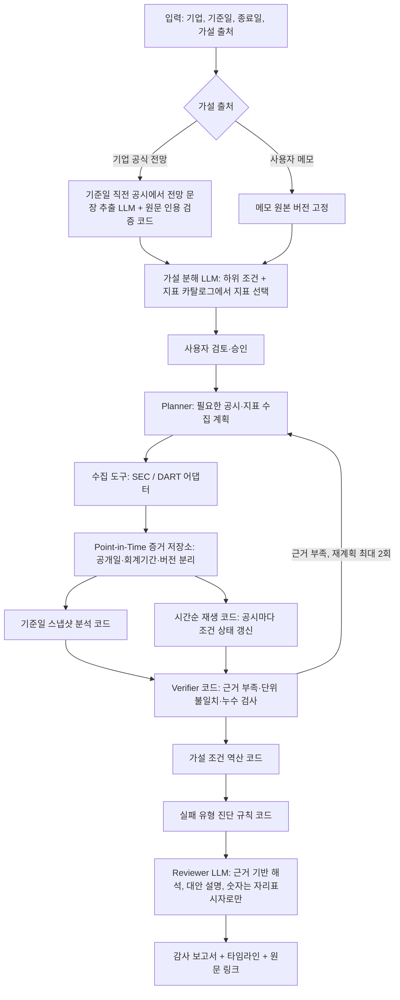

# 투자 판단 감사(Decision Audit) 에이전트 — 기획 (v2)

> 가제: Thesis-ab / Thesis Replay (최종 서비스명 미정)
> 상태: 기획 v2. v1(투자 가설 시간순 재생)에서 포지셔닝을 "투자 판단 감사"로 바꿨다.
> 대상: 「국부펀드 KIC, AI 에이전트 공모전」 (예선 기획서 11/12, 본선 12/22)

## 0. v1 대비 바뀐 점

| 항목 | v1 | v2 |
|---|---|---|
| 정체성 | 투자 가설을 시간순으로 재생하는 도구 | **투자 판단이 왜 틀렸는지(또는 맞았는지) 감사하는 도구** |
| 핵심 산출물 | 가설 상태 타임라인, 최초 경고 시점 | 위 항목 + **판단 실패 유형 진단(4분류)** + 위원회 보고서 |
| 사용 시점 | 사후 리뷰만 | 사후 리뷰 + 보유 자산 정기 점검(기준일 = 투자일, 종료일 = 오늘) + 신규 심의 시 경영진 전망 신뢰도 확인 |
| 데모 가설 | 사용자 메모 | **기준일에 공시된 기업 공식 전망**(사후 편향 없음). 사용자 메모는 별도 입력 모드 |
| 지표 | LLM이 자유롭게 정의 | **고정 지표 카탈로그**에서 LLM이 선택, 계산은 코드 |
| 임계값 | 근거 없으면 "미정" | 사용자 입력이 없으면 **코드로 정한 기본 규칙**("기본 규칙" 라벨) |
| 스트레스 테스트 | 가치평가 모델 기반(정의 없음) | **가설 조건 역산**(가설이 맞으려면 남은 기간에 얼마가 필요했나) |
| UI | FastAPI + React | Streamlit |
| AI 자체의 사후 편향 차단 | 없음 | **추후 기능**(11장) |

## 1. 한 문장 정의

과거의 투자 판단을 입력하면, 판단 당시 공개돼 있던 정보와 그 이후 공개된 정보를 날짜 기준으로 엄격히 나눠 시간순으로 다시 재생하고, **그 판단이 "가정이 무리했다 / 신호를 놓쳤다 / 상황이 바뀌었다 / 일시적으로 흔들렸다" 중 무엇이었는지**를 근거와 함께 진단하는 AI Agent.

## 2. 문제 정의

투자 결과가 나쁘면 흔히 "판단이 틀렸다"로 끝난다. 그런데 결과만으로 판단을 평가하면 다음을 구별할 수 없다.

| 실패 유형 | 의미 | 조직이 배워야 할 것 |
|---|---|---|
| 가정 무리 | 판단 당시 자료로 봐도 가설이 성립하려면 비현실적인 수치가 필요했다 | 가설 설정·심사 기준 강화 |
| 신호 놓침 | 판단 당시 이미 공개된 반대 신호가 있었는데 판단에 반영되지 않았다 | 체크리스트·실사 범위 보강 |
| 상황 변화 | 당시엔 합리적이었으나 이후 새 정보로 조건이 지속적으로 깨졌다 | 모니터링·재검토 주기 개선 (판단 자체는 문책 대상 아님) |
| 일시적 흔들림 | 지표가 잠깐 나빠졌다가 회복됐다 | 과잉 대응 방지 |

이 구분이 안 되면 같은 실수를 반복하거나, 반대로 합리적이었던 판단을 결과만 보고 처벌하게 된다(결과 편향). 기관 투자자, 특히 국민 자산을 운용하는 국부펀드는 **"당시 이용 가능한 정보로 합리적인 판단이었는가"**를 설명할 책임이 크다.

수작업으로 이 감사를 하려면 담당자가 과거 공시를 날짜별로 다시 모으고, 정정 공시 이전 숫자를 찾고, 지표를 다시 계산해야 해서 건당 며칠이 걸린다. 그래서 실제로는 잘 하지 않는다.

## 3. 사용 상황

| # | 상황 | 사용자 | 빈도 | 입력 | 받는 결과 |
|---|---|---|---|---|---|
| 1 | **성과 미달 자산 사후 리뷰** | 투자심의 지원, 리스크·사후관리 담당 | 분기·반기 | 당시 심의 메모 + 투자일 | 실패 유형 진단, 최초 경고 시점, 위원회 보고서 초안 |
| 2 | **보유 자산 정기 점검** (실적 시즌) | 포트폴리오 매니저, 애널리스트 | 분기 | 원래 투자 가설 + 투자일, 종료일 = 오늘 | 가설별 현재 상태, 깨지기 시작한 조건, 가설 유지에 필요한 남은 수치 |
| 3 | **신규 투자 심의 전 경영진 전망 신뢰도 확인** | 리서치 애널리스트 | 심의 건마다 | 기업명 | 과거 기간별 "경영진 전망 → 실제 결과" 감사 이력 |
| 4 | **손실·성과 설명 요구 대응** (내부 감사, 이사회, 외부 질의) | 투자관리·감사 대응 담당 | 비정기 | 당시 판단 자료 | 판단 시점의 정보 집합과 이후 정보를 분리한 증빙 |
| 5 | **리서치 교육·사례 라이브러리** | 신입 애널리스트, 리서치 팀장 | 상시 | 감사 결과 누적 | 실패 유형별 사례집 |

사용 빈도의 중심은 2번(분기마다)이고, 1·4번은 이 도구만 할 수 있는 고가치 업무다. 3번은 기업 공식 전망을 가설로 쓰는 데모 구조에서 그대로 나오는 부산물이다.

## 4. 차별화

| 기능 | 기존 서비스 (TickerTrac, readouts.ai, Helm, ThesisLoop 등) | 이 서비스 |
|---|---|---|
| 가설 분해·공시 대조 | 있음 | 있음 (기본 기능) |
| 가설 상태 판정 | 있음 (intact/challenged 등) | 있음 |
| 시간순 재생 | 일부 있음 (버전 이력) | 있음 + **공개일 기준 엄격 분리, 정정 전 값 복원** |
| **판단 실패 유형 진단** | 없음 | **핵심** |
| **당시 알 수 있었던 신호 vs 사후 정보 구분** | 없음 | **핵심** |
| **가설 조건 역산** (성립에 필요했던 수치) | 없음 | 있음 |
| 대상 | 개인 투자자, 앞으로의 감시 | **기관의 판단 품질 관리·설명 책임** |

기존 서비스는 "가설이 지금 깨졌는가"를 말한다. 이 서비스는 "그 판단이 **왜**, **어떤 종류로** 틀렸고, 당시 알 수 있었는가"를 말한다.

차별성은 데모로 보여준다: 같은 기업을 기준일 시점 분석과 후속 정보 반영 분석으로 나란히 놓고, 실패 유형이 어떤 근거로 판정됐는지 클릭해서 원문까지 따라갈 수 있게 한다.

## 5. Agent 파이프라인

### 역할 분담 (비용 최소화)

| LLM (호출 3~5회/건) | 코드 |
|---|---|
| 공시·메모에서 전망/가설 문장 추출 (원문 인용 필수) | 인용문이 원문에 실제로 있는지 검사 |
| 가설을 하위 조건으로 분해, 지표 카탈로그에서 선택 | 지표 계산, 날짜 필터, 정정 공시 버전 관리 |
| 메모·전망이 특정 신호를 언급했는지 판정 (인용 필수) | 조건 상태 판정, 최초 경고 시점, 실패 유형 판정 |
| 검색 계획 보조, 근거 해석·대안 설명 문장 작성 | 가설 조건 역산, 보고서 숫자 채우기 |

LLM은 숫자를 직접 쓰지 않는다. 보고서 문장의 숫자는 `[[fact_key]]` 자리표시자로만 쓰고, 코드가 계산값으로 치환한다. 자리표시자 밖에서 숫자가 나오면 감사에서 탈락시킨다(kr-fund-ai-agent 방식 재사용).

## 6. 단계별 정의

### Stage 1 — 입력
- 기업 식별자(종목코드, CIK, 기업명), 기준일, 종료일(기본값 오늘)
- 가설 출처: **기업 공식 전망**(데모 기본) 또는 **사용자 메모**(붙여넣기·텍스트 파일)
- 기준일이 없으면 진행하지 않는다. 임의로 추정하지 않는다.

### Stage 2 — 가설 추출·분해
- 기업 공식 전망 모드: 기준일 이전 가장 최근 정기 공시(10-K/10-Q의 MD&A, 사업보고서의 사업 전망)와 실적 발표 자료에서 전망 문장을 추출한다. 원문 인용이 확인된 문장만 남긴다.
- 하위 조건 필드: `id`, `statement`, `type`(재무·수요·경쟁·운영·거시), `indicators`(카탈로그 ID), `direction`(증가·유지·감소), `threshold`(사용자 입력 또는 원문 수치, 없으면 기본 규칙), `horizon`, `source_quote`, `user_confirmed`
- 사용자가 수정·삭제·승인한다.

### Stage 3 — 지표 카탈로그 (코드)
15~20개 고정 지표. 각 지표마다 계산식, US-GAAP 태그, K-IFRS 계정 매핑, 단위를 코드로 정의한다.
예: 매출 YoY, 매출총이익률, 영업이익률, 재고자산 증가율 − 매출 증가율, 매출채권 회전일수, 이연수익, CapEx/매출, 영업현금흐름/순이익, 순차입금/EBITDA, 연구개발비/매출 등.
카탈로그에 없는 조건은 "정량 검증 불가"로 표시하고, 텍스트 근거만 수집한다.

### Stage 4 — 수집과 Point-in-Time 저장소
- 데이터: SEC EDGAR(submissions, companyfacts), OpenDART(공시 목록, 재무제표)
- 모든 값에 `period_end`(회계기간), `published_at`(공개일), `retrieved_at`(수집 시각), `source_document_id`(접수번호), `version`을 저장한다.
- 기준일 T 분석에는 `published_at <= T`인 값만 노출한다. 같은 기간 값이 여러 공시에 있으면 T 시점에 공개돼 있던 가장 최신 버전을 쓴다.
- 정정 공시는 덮어쓰지 않고 새 버전으로 보존한다.
- 알려진 한계: 미국 기업은 실적을 8-K 보도자료로 먼저 공개하는데, 이 숫자는 XBRL에 없다. 그래서 "XBRL 기준 공개일"이 실제 최초 공개일보다 늦을 수 있고, 이를 보고서에 표시한다.

### Stage 5 — 시간순 재생과 조건 상태 (코드)
공시가 하나 추가될 때마다 각 하위 조건의 상태를 다시 판정한다.
- 상태: `supported`(지지) / `weakened`(약화) / `mixed`(혼합) / `insufficient`(근거 부족)
- 판정 기준은 사용자 임계값이 우선이고, 없으면 기본 규칙을 쓴다. 예: 방향 반전, 2분기 연속 둔화, 재고 증가율이 매출 증가율을 초과.
- 기본 규칙에는 "기본 규칙" 라벨을 붙이고, 사용자가 바꿀 수 있다.

### Stage 6 — 가설 조건 역산 (코드)
"가설이 맞으려면 남은 기간에 얼마가 필요했나"를 계산한다.
- 예: "2년 매출 CAGR 15%" 가설이면, 각 시점까지의 실적을 반영해 남은 분기에 필요한 성장률을 계산한다.
- 필요 수치를 기준일 이전 실적 범위(과거 최고·최저, 분포)와 비교한다. 이 결과를 실패 유형 판정 중 "가정 무리"에 쓴다.
- 모든 결과는 "조건부 계산"으로 라벨링하고, 계산식·입력값·기준 시점을 노출한다.

### Stage 7 — 판단 실패 유형 진단 (코드 규칙 + LLM 설명)
하위 조건별로 판정한 뒤 가설 전체를 요약한다. 규칙은 코드로 정의하고, 판정 근거(어떤 공시, 어떤 수치)를 함께 남긴다.

| 유형 | 판정 규칙 (초안) |
|---|---|
| 가정 무리 | 기준일 시점 역산 결과, 필요 수치가 기준일 이전 과거 실적 범위를 벗어남 |
| 신호 놓침 | 기준일 시점 스냅샷에서 이미 `weakened`인 조건이 있고, 가설 문서가 그 신호를 언급하지 않음 (언급 여부는 LLM이 인용과 함께 판정, 코드가 인용 검증) |
| 상황 변화 | 기준일 시점 `supported` → 기준일 이후 `weakened` 전환 후 다음 공시까지 회복하지 않음 |
| 일시적 흔들림 | `weakened` 전환 후 다음 공시에서 `supported`로 회복 |
| 가설 유지 | 종료일까지 `supported` 유지 |
| 판단 불가 | 근거 부족 |

"최초 경고 시점"은 기계적 신호가 처음 관측된 공시일이다. 그날 매도했어야 한다는 뜻이 아니고, 결과의 원인이라고 단정하지 않는다.

### Stage 8 — 감사 보고서
1. 한눈에 보는 결론 (가설별 실패 유형)
2. 원래 가설과 하위 조건 (원문 인용)
3. 기준일 당시 이용 가능했던 핵심 증거
4. 시간순 타임라인과 최초 경고 시점
5. 가설 조건 역산 결과
6. 당시 알 수 있었던 신호 vs 사후에야 알게 된 정보
7. 반대 증거와 대안적 설명
8. 데이터 공백·분석 한계
9. 후속 검토 질문
10. 출처 목록

매수·매도 추천은 하지 않는다. 목적은 판단 과정의 품질 관리다.

## 7. 화면 (Streamlit)

| 탭 | 내용 |
|---|---|
| 새 감사 | 기업, 기준일, 종료일, 가설 출처 선택 |
| 가설 검토 | 추출된 가설·하위 조건, 원문 인용, 수정·승인 |
| 타임라인 | 조건별 상태 변화, 공시 단위 재생 슬라이더, 기준일 전후 시각 구분, 원문 링크 |
| 진단 | 실패 유형, 판정 근거, 가설 조건 역산 표·차트 |
| 보고서 | 감사 보고서 보기, Markdown 내보내기 (PDF는 후순위) |
| 데이터·출처 | 수집 기록, 공개일, 버전, 실패 항목 |

## 8. 데이터·신뢰성 원칙
- 기준일 이후 공개 자료가 기준일 분석에 섞이지 않는 것을 최우선으로 한다. 자동 테스트로 보장한다.
- 원문 근거가 없는 주장은 검증 완료로 표시하지 않는다.
- 사실, 계산, 추론, 미확인 사항을 UI에서 분리한다.
- 이상 신호를 부정·위법으로 단정하지 않고, 동시 발생을 인과로 표현하지 않는다.
- 도구는 값과 함께 근거(evidence)와 한계(unknowns)를 반환한다. unknowns 메시지에는 숫자를 쓰지 않는다.
- 외부 데이터·코드·모델의 출처와 이용 조건은 `SOURCES.md`에 기록한다(기존 두 저장소에서 재사용한 코드 포함).

## 9. MVP 범위

**필수**
- 기업 공식 전망 모드 + 사용자 메모 모드
- SEC, DART 어댑터 (진행 순서는 12장 미정 사항)
- 지표 카탈로그 15~20개
- Point-in-Time 저장소 (공개일·버전 보존)
- 시간순 재생, 조건 상태, 최초 경고 시점
- 가설 조건 역산
- 실패 유형 진단
- 감사 보고서 (Markdown)
- 데모 사례 2~3건

**제외**
- 뉴스 전수 검색, 실시간 알림
- 가치평가(DCF) 기반 스트레스 테스트
- 매매 추천, 목표주가
- KIC 내부 시스템 연동
- 스캔 PDF OCR

## 10. 평가 지표·필수 테스트

| 지표 | 목표 |
|---|---|
| Point-in-Time 무결성 (기준일 분석에 이후 자료 유입 0건) | 100% |
| 인용 정확도 (인용문이 원문에 존재) | 100% (코드 검증) |
| 재현성 (같은 입력·스냅샷 → 같은 결과) | 100% |
| 실패 유형 판정의 사람 검토 일치율 | 측정 후 보고 (표본이 적으면 한계 명시) |
| 건당 소요 시간·LLM 비용 | 측정 후 보고 |

필수 테스트: 기준일 이후 공시 배제, 정정 공시 버전 보존, 원문에 없는 인용 거부, 근거 부족 시 `insufficient`, 단위·통화·회계기간 불일치 비교 거부, 수집 실패 시 사유 표시, 실패 유형 규칙별 단위 테스트.

## 11. 추후 기능
1. **AI 자체의 사후 편향 차단**: LLM은 학습 데이터로 기준일 이후의 사건을 이미 알 수 있다. 기업명·제품명·날짜를 가려 "A사"로 넣고, 가린 입력과 원래 입력의 결과 차이로 누수를 검사한다. 관련 연구: HindsightBench, Look-Ahead-Bench (2026).
2. **경영진 전망 신뢰도 누적 점수**: 여러 기간의 감사 결과를 쌓아 기업별 전망 적중 이력을 만든다.
3. **위탁운용사 투자 논리 감사**: 운용사가 제시한 투자 논리를 같은 엔진으로 감사한다.
4. 뉴스·실적 발표 원문(8-K 보도자료) 반영, 가치평가 기반 스트레스 테스트, PDF 보고서, MCP 서버 공개.

## 12. 미정 사항

| 항목 | 선택지 |
|---|---|
| SEC/DART 진행 순서 | A) SEC를 먼저 끝까지 완성하고 DART를 같은 인터페이스로 붙이기 (추천) / B) 처음부터 동일 수준 |
| DART 정정 전 재무값 복원 가능 여부 | Phase 0에서 확인 |
| 데모 기업 선정 | 결과를 알고 고르는 선택 편향이 있으므로 기획서 한계에 명시. 유형별(상황 변화 / 신호 놓침 / 가설 유지) 1건씩 권장 |
| 실패 유형 판정 규칙의 세부 기준 (연속 분기 수 등) | 데모 사례로 검증 후 확정 |
| 최종 서비스명 | 미정 |

## 13. 재사용 코드

| 가져올 것 | 출처 |
|---|---|
| HTTP 캐시·호스트별 요청 간격·키 제거, 가짜 HTTP 테스트 | `fund-reversing-ai/tracer/http.py`, `tests/fakes.py` |
| SEC·DART 기업 식별, 공시 URL | `fund-reversing-ai/tracer/sources/sec.py`, `dart.py` |
| 원문 인용 검증 | `fund-reversing-ai/tracer/extract.py` (`verify`) |
| 공시 제목 키워드 분류 | `fund-reversing-ai/tracer/events/root_cause.py` |
| LLM 어댑터(Gemini/Claude, 캐시, 재시도), 숫자 자리표시자 감사 | `kr-fund-ai-agent/sentinel/agents/llm.py` |
| Planner → Executor → Verifier(재계획 ≤2) → Reviewer 구조 | `kr-fund-ai-agent/sentinel/agents/pipeline.py` |
| 도구 반환 형식(값 + 근거 + 한계), 데이터 품질 검사 | `kr-fund-ai-agent/sentinel/tools.py`, `data/quality.py` |

## 14. 개발 단계

| 단계 | 내용 | 완료 조건 |
|---|---|---|
| Phase 0 | 저장소 뼈대, 공용 코드 이식, 샘플 기업 공시 2~3건으로 공개일·버전 복원 확인 (SEC, DART) | 한 기업의 2개 이상 시점을 원문·공개일과 함께 재구성 |
| Phase 1 | 지표 카탈로그, Point-in-Time 저장소, 기준일 필터 | 날짜 필터·계산 자동 테스트 통과 |
| Phase 2 | 가설 추출(전망·메모), 사용자 승인, 인용 검증 | 실제 공시 기반 샘플 1건의 가설·근거 목록 |
| Phase 3 | 시간순 재생, 역산, 실패 유형 진단 | 가설 2개 이상에서 시점별 결과·유형 판정 재현 |
| Phase 4 | Streamlit UI, 보고서, 데모 2~3건, 배포 | 데모 URL에서 처음부터 끝까지 동작 |
| 예선 (11/12) | 기획서 PDF 10쪽 | Phase 0~1 결과와 데모 사례 1건을 근거로 첨부 |
| 본선 (12/22) | MVP, 데모 URL, 발표자료 | 필수 제출물 완료 |
